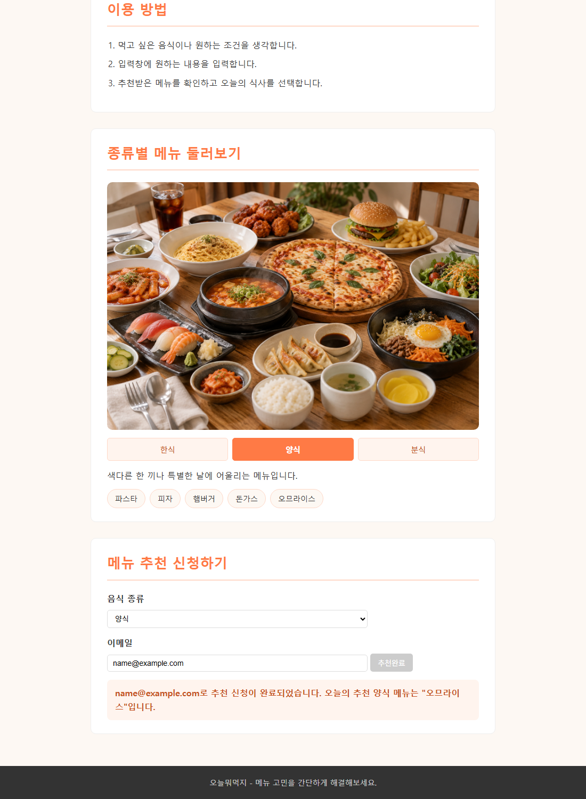
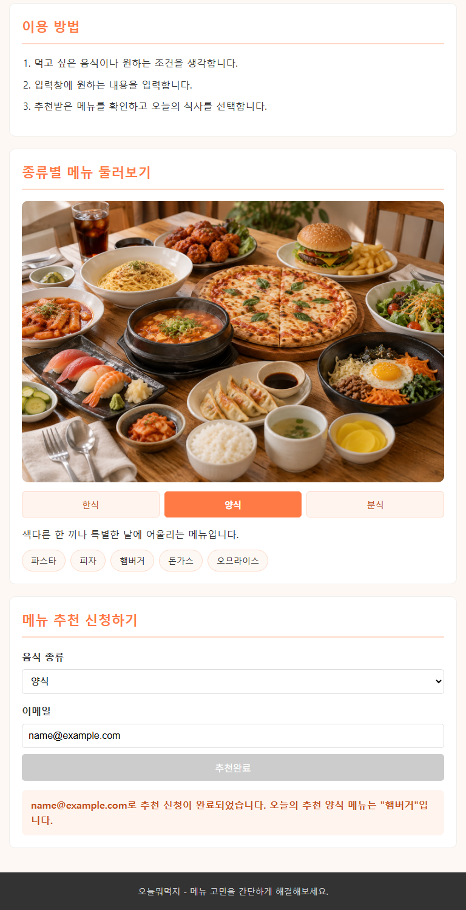
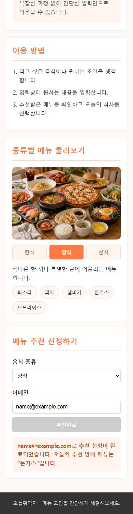

# 오늘뭐먹지

- 배포: https://gitdevtori.github.io/iscu-uiuxprogramming/
- 저장소: https://github.com/gitdevtori/iscu-uiuxprogramming

## 구현한 이벤트

| 이벤트 | 대상 | 동작 |
|---|---|---|
| click | 메뉴 탭 (`.tab`) | 한식 / 양식 / 분식 탭 전환 |
| change | 음식 종류 선택 (`#category`) | 추천할 음식 종류 변경 |
| input | 이메일 입력창 (`#email`) | 이메일 형식 실시간 검사 |
| submit | 추천 신청 폼 (`#recommend-form`) | 메뉴 추천 |

## 화면 변화

| 사용자 행동 | 문구 | 스타일 | 버튼 상태 |
|---|---|---|---|
| 탭 클릭 | 선택한 탭의 메뉴만 표시 | 선택한 탭 주황 배경(`is-active`) | - |
| 음식 종류 변경 | "○○ 메뉴 중에서 추천해 드릴게요." | 노란 안내 박스(`is-info`) | "추천받기"로 복귀 |
| 틀린 이메일 입력 | "name@example.com 형식으로 입력해 주세요." | 빨간 힌트, 빨간 테두리(`is-invalid`) | 비활성화 |
| 올바른 이메일 입력 | 힌트 숨김 | 빨간 테두리 제거 | 활성화 |
| 추천받기 | "…오늘의 추천 ○○ 메뉴는 "…"입니다." | 주황 성공 박스(`is-success`) | "추천완료", 비활성화 |

## 테스트 결과

| 확인 항목 | 1100px | 768px | 390px |
|---|---|---|---|
| 탭 클릭 시 선택 탭 강조, 해당 메뉴만 표시 | O | O | O |
| 음식 종류 변경 시 문구, 스타일, 버튼 변경 | O | O | O |
| 이메일 입력 시 힌트, 스타일, 버튼 변경 | O | O | O |
| 추천받기 시 결과 문구, 버튼 비활성화 | O | O | O |
| 화면 잘림, 가로 스크롤 없음 | O | O | O |

| 1100px | 768px | 390px |
|---|---|---|
|  |  |  |
